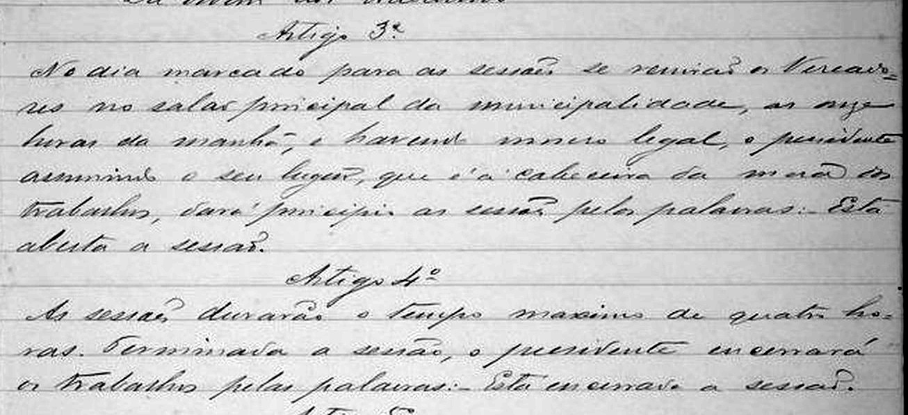
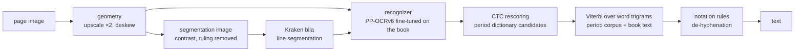

# OCR pipeline for 19th-century handwritten records

Handwritten text recognition for the **Livro de Registro de Leis nº 1** (1892–1894), the first law register of
the São Carlos city council (São Paulo, Brazil). The pipeline runs locally and needs no transcription service. It uses a
[Kraken](https://github.com/mittagessen/kraken) line recognizer adapted to this book, a dictionary and word trigrams
built from period texts, and a configuration chosen by a conditional greedy search.

<p align="center">
  
</p>

What the final pipeline (v6) reads from the excerpt above:

```text
Artigo 3.º
No dia marcado para as sessões se reunirão os Vereadores
no salão principal da municipalidade, as onze
horas da manha, e havendo numero legal, o presidente
assumindo o seu lugar, que é á cabeceira da mesa dos
trabalhos, dará principio as sessões pelas palavras: - Estadista
a sessão.
Artigo 4.º
As sessões durarão o tempo maximo de quatro horas.
Terminada a sessão, o presidente encerrará
os trabalhos pelas palavras: - Está encerrada a sessão.
```

Period spelling (_maximo_, _numero_, _principio_) is kept on purpose. _Estadista_ should read _Está aberta_.

## Results

Word and character error rates (WER/CER, %): lowercased, punctuation removed, computed over the whole corpus.

| reference                                          | pages                                   |       WER |      CER |
| -------------------------------------------------- | --------------------------------------- | --------: | -------: |
| official transcription                             | 3 held-out pages                        | **18.74** | **4.43** |
| official transcription                             | all 12 transcribed pages                |     19.40 |     5.27 |
| diplomatic transcription (LLM, not human-reviewed) | 13 pages outside training and selection |      4.10 |     1.68 |

The two references disagree with each other. The official one modernizes spelling, expands abbreviations and has some
misreadings. The diplomatic one keeps the original spelling, but no person has reviewed it. Notation alone (how
ordinals like `1.º` are written) accounts for 5.6 WER points against the official reference.

How the error fell from version to version (all configuration choices were made on the 9 tuning pages):

| version     | what changed                                                                                   | tuning WER | held-out WER | held-out CER |
| ----------- | ---------------------------------------------------------------------------------------------- | ---------: | -----------: | -----------: |
| baseline    | PP-OCRv6 _medium_ on the raw image                                                             |      63.15 |        64.57 |        21.71 |
| v1          | separate images for segmentation and recognition, modern lexicon, CTC rescoring, greedy search |      46.95 |        48.66 |        17.79 |
| v3          | period dictionary, n-gram context                                                              |      36.00 |        36.85 |        14.00 |
| v4 _medium_ | ordinals, short words, n-best candidates, legislative corpus                                   |      29.63 |        28.50 |        10.64 |
| v4          | recognizer self-trained on the book's other pages                                              |      24.77 |        22.05 |         8.16 |
| v5          | recognizer trained on diplomatic transcriptions, book text in the context model                |      19.98 |        18.43 |         4.13 |
| **v6**      | **same configuration, recognizer retrained on a clean chain**                                  |  **19.64** |    **18.74** |     **4.43** |

## How it works



- **Image.** One image defines the coordinates (upscaled ×2 and deskewed). From it, a contrast-enhanced copy with the
  ruling lines removed goes to segmentation, and the plain copy goes to the recognizer.
- **Recognizer.** PP-OCRv6 _medium_ (Kiessling, [Zenodo 10.5281/zenodo.21788410](https://doi.org/10.5281/zenodo.21788410)),
  fine-tuned on 78 other pages of the book. Their labels are diplomatic transcriptions produced with Gemini 4 Argon.
  None of the 12 evaluated pages, and no human transcription, was used to train the weights.
- **Post-correction.** For each word, candidates from a period dictionary are scored with the recognizer's own CTC
  posteriors. A Viterbi pass over word trigrams then picks the line. The dictionary and the trigrams come from 443
  Portuguese books on Project Gutenberg (authors born 1790–1875) and 3,565 São Paulo state laws from 1889–1910.
- **Search.** Each option enters only if it beats the choices already made. Every pass goes forward and backward, so
  no option is discarded for good: an option that hurt alone can come back once others are in. The searches add up to
  about 2,300 evaluations and 92 hours of compute.

The full configuration is [`configs/final_v6.json`](configs/final_v6.json).

## Quick start

**Colab (no install):** open [`notebooks/presentation.ipynb`](notebooks/presentation.ipynb) in Colab
(_File → Open notebook → GitHub_) and run all cells. It is saved with its outputs, so you can also just read it:
for each page it shows every image step, the segmentation, the text after each stage and the errors against the
reference.

**Local:**

```bash
git clone https://github.com/DeguShi/OCR-pipeline-historical-data.git
cd OCR-pipeline-historical-data
python -m venv .venv && source .venv/bin/activate
pip install -r requirements.txt
python setup_pipeline.py --skip-install      # downloads and hash-checks the recognizer from the Hugging Face Hub

# evaluate the final configuration on the 3 held-out pages
python -m ocr_pipeline.run --config configs/final_v6.json --pages heldout --viz

# transcribe your own images (one .txt per image)
python -m ocr_pipeline.batch --config configs/final_v6.json --images my_pages/ --out outputs/batch
```

[`notebooks/new_images.ipynb`](notebooks/new_images.ipynb) does the same for a folder of new images. It can also crop
full scans from the archive. Python 3.12, CPU or CUDA; a page takes one to two minutes on a laptop CPU.

## Repository

| path                               | contents                                                                                                       |
| ---------------------------------- | -------------------------------------------------------------------------------------------------------------- |
| `ocr_pipeline/`                    | the pipeline: preprocessing, segmentation, recognition, CTC rescoring, context model, metrics                  |
| `ocr_pipeline/tuning/`             | greedy and random search, sweeps, training-data preparation                                                    |
| `configs/`                         | frozen configuration of every version (`final_v6.json` is the final one)                                       |
| `sweeps/`                          | search specifications                                                                                          |
| `tools/`                           | corpus download and dictionary building, reference comparison, final scoring                                   |
| `notebooks/`                       | presentation notebook (executed) and the notebook for new images                                               |
| `data/images`, `data/ground_truth` | the 12 evaluated pages and their official transcription                                                        |
| `data/ground_truth_gemini`         | diplomatic transcriptions of the same 12 pages                                                                 |
| `data/extra/`                      | the book's other pages, training crops and their diplomatic transcriptions, the 10 test pages                  |
| `models/lexicon/`                  | period dictionary and trigram model used by the final configuration                                            |
| `records/`                         | every search, sweep and training run, so work can resume from what was measured ([details](records/README.md)) |
| `docs/`                            | development log in Portuguese ([`PROCESS.md`](docs/PROCESS.md)) and the greedy search report                   |

Recognizer weights live on the Hugging Face Hub
([KobayashiShiroe/OCR-pipeline-historical-data](https://huggingface.co/KobayashiShiroe/OCR-pipeline-historical-data)):
`st_c1m` (v6, final) and `st_g3m` (v5). `setup_pipeline.py` downloads them and checks their SHA-256.

## Protocol

- **Split.** The 12 pages with an official transcription are split with seed 42 into 9 tuning pages and 3 held-out pages (7, 10, 12).
  10 more pages, with a diplomatic reference only, form a test set.
- **Selection.** Every choice of the final configuration was made on the tuning pages. The held-out pages were scored
  once, after the configuration was frozen. They had been looked at in earlier exploratory work, so the separation is
  not perfectly blind.
- **Training.** The recognizer was trained only on the 78 training pages of the book, never on the 12 evaluated
  pages or the test pages.

## Data and credits

The page images and the official transcription belong to the
Fundação Pró-Memória de São Carlos. They are included here only to
reproduce the results. Rights remain with the Foundation, so contact it before any other use. The diplomatic
transcriptions were produced with Gemini 4 Argon. They were used as training labels and as a second reference, and
they were not reviewed by a person.

This work started as the OCR part of a course project (SCC0287, ICMC-USP) in collaboration with the Foundation. The
original team repository is
[fabiolobato/hackathon_ocr_historico](https://github.com/fabiolobato/hackathon_ocr_historico), and the full
development history is on its `feat/clean_chain` branch.

Code: MIT ([LICENSE](LICENSE)). Data and weights: see above.

---

## Em português

Pipeline de OCR para o _Livro de Registro de Leis nº 1_ (1892–1894) da Câmara de São Carlos. O pipeline roda
localmente, sem serviço de transcrição. O reconhecedor Kraken foi adaptado à letra do livro. Um dicionário e trigramas
de época, tirados de livros do século XIX e de leis paulistas de 1889–1910, fazem a pós-correção. Todas as escolhas
vieram de uma busca gulosa condicional feita só nas páginas de ajuste.

Contra o gabarito oficial, nas 3 páginas reservadas, o WER fica em **18,74%** e o CER em **4,43%**. Contra as
transcrições diplomáticas, em 13 páginas fora do treino e da seleção, os valores são 4,10% e 1,68%. Essa referência
foi gerada por LLM e não foi revisada por pessoas.

Para ver o pipeline funcionando, abra [`notebooks/presentation.ipynb`](notebooks/presentation.ipynb), que está em
português e já executado. O processo completo, com os experimentos, os números e o que não funcionou, está em
[`docs/PROCESS.md`](docs/PROCESS.md). Os registros de todas as buscas e treinos ficam em [`records/`](records/).
